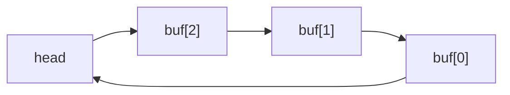

# Khảo sát tổ chức buffer cache

Người thực hiện: Đồng Xuân Quang — MSSV 20233603.

Commit khảo sát: 5f9de937b91cf3b3e112c41e18bc2f989af7b35d.

Tài liệu mô tả tổ chức buffer cache hiện tại trong mã nguồn.
Chưa triển khai hash bucket hoặc đo hiệu năng. Đang chờ Trung đọc chéo.

## 1. Các thành phần chính

Buffer cache giữ bản sao các block đĩa trong RAM, giúp giảm việc
đọc đĩa lặp lại và hỗ trợ đồng bộ truy cập vào cùng block.

| Thành phần | Vị trí | Vai trò |
|---|---|---|
| bcache.lock | kernel/bio.c | Spinlock chung bảo vệ metadata quản lý cache |
| bcache.buf[NBUF] | kernel/bio.c | Mảng chứa các buffer |
| bcache.head | kernel/bio.c | Nút lính canh của danh sách liên kết vòng |
| struct buf | kernel/buf.h | Dữ liệu và thông tin quản lý một buffer |
| NBUF | kernel/param.h | Số lượng buffer |
| BSIZE | kernel/fs.h | Kích thước dữ liệu của một block |
| binit() | kernel/bio.c | Khởi tạo cache |
| main() | kernel/main.c | Gọi binit() khi khởi tạo kernel |

NBUF = MAXOPBLOCKS * 3 = 10 * 3 = 30.
BSIZE = 1024 byte.

Tổng vùng data của 30 buffer là 30720 byte, tương đương 30 KiB.
Con số này chưa bao gồm khóa, con trỏ và metadata.

## 2. Quan hệ giữa mảng và danh sách

Mảng bcache.buf chứa các buffer thật. Những buffer này đồng thời
được nối thành danh sách bằng hai con trỏ prev và next.
Đây là hai cách tổ chức cùng một tập buffer, không phải hai bản sao.

bcache.head là nút lính canh, không phải buffer dữ liệu thứ 31.

- head.next trỏ đến đầu danh sách.
- head.prev trỏ đến cuối danh sách.
- Đi theo next hoặc prev đều có thể quay lại head.

Sơ đồ dưới đây minh họa với ba buffer. Mũi tên biểu diễn next;
prev nối theo chiều ngược lại. Bản khảo sát thực tế có 30 buffer.

## 3. Quá trình khởi tạo trong binit()

Hàm binit() thực hiện:

1. Khởi tạo bcache.lock bằng initlock().
2. Cho head.next và head.prev cùng trỏ về head để tạo danh sách rỗng.
3. Duyệt từng phần tử của bcache.buf.
4. Chèn buffer đang xét ngay sau head.
5. Khởi tạo sleeplock riêng của buffer bằng initsleeplock().
6. Cập nhật các liên kết để duy trì danh sách vòng hai chiều.

Do mỗi buffer đều được chèn vào đầu, sau khởi tạo, thứ tự theo
next là head, buf[29], buf[28], ..., buf[0], rồi trở lại head.

binit() không đọc dữ liệu block từ đĩa. bcache là biến toàn cục
được khởi tạo tĩnh; các trường như valid và refcnt ban đầu bằng 0,
không phải do vòng lặp trong binit() gán từng trường.

## 4. Khóa chung và khóa riêng

bcache.lock được sử dụng trong bget(), brelse(), bpin() và bunpin().
Khóa này bảo vệ việc tra cứu/cập nhật danh tính block, refcnt và
các thao tác thay đổi danh sách.

Mỗi buffer có một sleeplock riêng để độc quyền sử dụng nội dung
buffer. Khóa chung và khóa riêng có vai trò khác nhau.

Trong bget(), refcnt được tăng khi còn giữ khóa chung.
Sau đó khóa chung được nhả trước khi chờ lấy sleeplock của buffer.

refcnt tính cả các tham chiếu do pin; refcnt bằng 0 là điều kiện
để bget() chọn buffer đó cho việc tái sử dụng.

## 5. Thứ tự sử dụng và nhận xét ban đầu

bget() tìm buffer theo cặp dev và blockno bằng cách duyệt danh sách.
Nếu không tìm thấy, hàm duyệt từ cuối danh sách và chọn buffer đầu
tiên có refcnt bằng 0 để tái sử dụng.

Trong brelse(), sau khi giảm refcnt, buffer chỉ được chuyển lên
đầu danh sách nếu refcnt trở thành 0. bunpin() giảm refcnt nhưng
không tự chuyển buffer lên đầu.

Tìm kiếm hiện tại có độ phức tạp O(NBUF). Một khóa chung có thể
gây tranh chấp khi nhiều CPU cùng thao tác metadata của cache.
Đây là nhận xét từ mã nguồn, chưa phải kết quả đo thực nghiệm.

## 6. Câu hỏi cần thảo luận

- Khi chia hash bucket, khóa nào bảo vệ việc chuyển buffer giữa bucket?
- Làm sao tránh hai buffer cùng đại diện cho một cặp dev và blockno?
- Thứ tự lấy nhiều khóa cần quy định thế nào để tránh deadlock?
- Khi thay bằng timestamp LRU, thời điểm cập nhật timestamp là khi nào?
